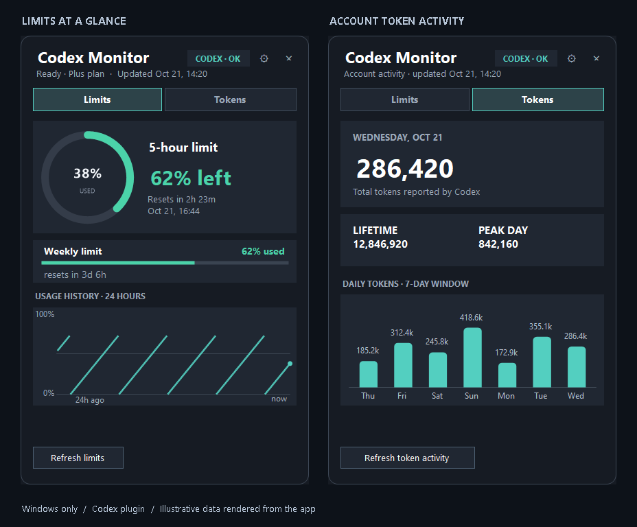

# Codex Monitor

**Your Codex limits and token activity, one click from the Windows clock.**


A small native tray app with a readable usage ring, reset countdowns and daily token totals. **Codex is the only supported plugin. Windows is the only supported operating system.**



*Real application controls rendered directly into memory with illustrative data. No desktop or account screenshots. [Limits](docs/images/limits.png) · [Tokens](docs/images/tokens.png)*

## At a glance

| Limits | Tokens | Tray controls |
| --- | --- | --- |
| Used percentage and remaining quota | Latest reported daily total | Select the limit shown next to the clock |
| Five-hour or weekly windows, when reported | Lifetime total and peak day, when available | Warning and critical thresholds |
| Time until each limit resets | Seven-day chart with values on the bars | Snooze alerts until reset |
| Local 24-hour percentage history | Exact values on hover or keyboard focus | Refresh and start with Windows |

Token activity and quota percentages measure different things. The app does not infer a token allowance, API spending or a subscription renewal date.

## Install

1. Get the latest published Windows installer from [Releases](https://github.com/ppotepa/codex-monitor/releases), or build the current source below. Screenshots show the current source; a published release may be older.
2. Install the [.NET 10 Desktop Runtime for Windows x64](https://dotnet.microsoft.com/en-us/download/dotnet/10.0) if needed. The small installer does not bundle the runtime.
3. Start **Codex Monitor** from the Start menu. Use Codex CLI signed in under the same Windows account.

Left-click the tray icon to open the dashboard. Right-click for alerts, the selected limit, startup settings and **AI agents...**. The agent screen shows which command-line agents are installed, which adapters are available, and which data source was selected. Windows may initially place the icon in the overflow menu; drag it next to the clock. Windows controls the tray icon's physical size.

### Codex plugin dependencies

- **Limits:** `codex-cli-usage.exe`, or the compatible `clanker-usage.exe` command. If missing or broken, the plugin attempts installation or repair through [uv](https://docs.astral.sh/uv/getting-started/installation/) with Python 3.12. Install `uv` in `PATH` or `%USERPROFILE%\.local\bin`. The fallback source is `git+https://github.com/wakamex/clanker-usage.git@v0.4.1`.
- **Tokens:** the installed Codex CLI (`codex.exe` or npm's `codex.cmd` launcher). The plugin starts its app-server temporarily to request account activity. Availability depends on the CLI version and what the signed-in account returns. The monitor does not install Codex CLI itself.

Installation and data refresh need network access through these dependencies. Codex Monitor uses their existing authentication; it does not ask for an API key or store credentials itself.

## Supported today

| Component | Status |
| --- | --- |
| Windows 10/11 x64 | Supported |
| Codex plugin | Built in; limits, token activity, dependency repair |
| Other providers | Not implemented |
| macOS / Linux / Windows ARM64 package | Not supported |
| External plugin installation | Not implemented; plugins are compiled into the app |

Detection is intentionally broader than support. The catalog can find a known executable without reading or launching it. Selection first honors a saved preferred supported agent, then chooses the first installed supported adapter. If none is installed, the Codex adapter remains selected so its repair flow can install the missing dependency. An installed agent without an adapter is displayed as detected but is never used as a data source.

The internal plugin boundary keeps provider integration separate from the Windows UI. It does not imply cross-platform support or compatibility with other providers.

## Project layout

The code is split by responsibility rather than by screen:

- `App/` hosts the Windows process and `UsageCoordinator`, which owns refresh state and transitions.
- `Core/` contains provider-neutral models, settings, history and alert policy.
- `Core/AgentCatalog.cs` defines known agents and the deterministic source-selection policy.
- `Plugins/Codex/` contains all Codex CLI and app-server integration.
- `UI/` contains WinForms controls and the tray presentation.
- `Infrastructure/Windows/` contains Windows-only integrations such as autostart and executable discovery.
- `tools/` and `tests/` are development-only projects and are excluded from the shipped executable.

## Build and verify

Requires Windows and the .NET 10 SDK. Building the installer also requires Inno Setup 6.

```powershell
dotnet build -c Release
dotnet run --project tests/ParserChecks.csproj
dotnet run --project tools/Screenshots/Screenshots.csproj
./scripts/build-installer.ps1
```

The current source builds `installer\CodexMonitor-0.4.0-Setup.exe`. To publish only the application:

```powershell
dotnet publish -c Release -r win-x64 --self-contained false -p:PublishSingleFile=true -o dist
```

The screenshot tool uses actual WinForms views and synthetic snapshots. It creates PNGs in `docs/images`, plus empty/loading/error renders in `build/screenshots`, without opening a window or reading account data. It also checks tab capabilities and sizing on short displays. These development tools and images are not included in the installed application.

## Data and privacy

The default refresh policy is deliberately gentle: limits every five minutes, token activity every 30 minutes while the Tokens view is open, and agent detection every 30 minutes. These intervals are configurable in **Settings...**. You can choose a faster limits cadence for active monitoring, keep token reads manual to reduce CLI wake-ups, or scan agents only at startup. A failed request retains the last successful values and displays an error; missing data is never shown as zero.

Preferences and alert state live in `%LOCALAPPDATA%\CodexMonitor\settings.json`. The local micro-store at `monitor.db.json` keeps limit samples and the last token snapshot in one atomic file. A cached token snapshot is shown immediately after startup and is reused until the configured token refresh interval expires; **Refresh token activity** bypasses that TTL. Existing `history.json` files are migrated automatically. Samples older than seven days are removed. The chart shows the last 24 hours with gaps when observations are missing. Codex Monitor does not persist credentials, prompts or conversations. The external CLIs manage their own authentication and caches.

See [architecture](docs/ARCHITECTURE.md) for the plugin boundary and [UI design](docs/UI-DESIGN.md) for layout and state behavior. Repository topics are declared in [.github/repository.json](.github/repository.json); applying them to GitHub is a separate publishing step.
