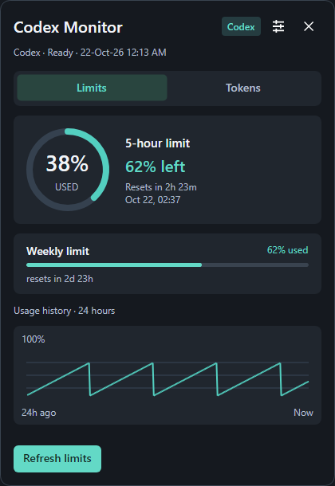
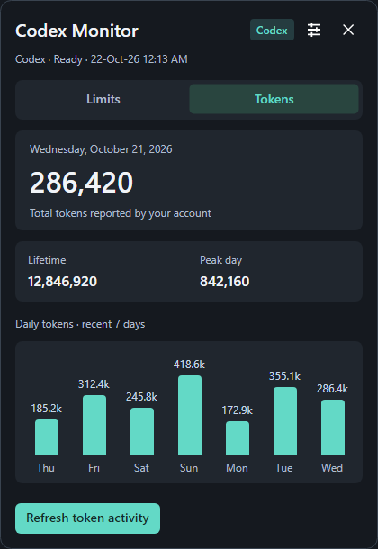
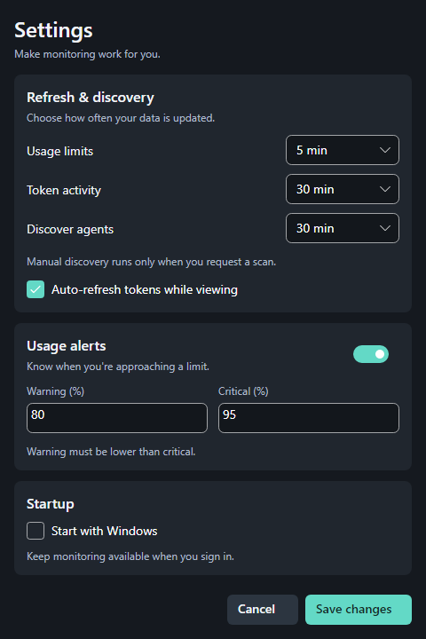

# Codex Monitor

**One Avalonia UI for Windows, Linux and macOS.**


Codex Monitor shows signed-in Codex CLI usage limits, reset countdowns,
seven-day token activity and local limit history from the desktop tray.

**Source version 0.5.3, Windows installer refreshed.** The
previously published Windows installers use an earlier implementation; do
not assume a GitHub Release contains these unverified changes.

## Shared presentation

The compact dashboard uses a custom draggable header, full-width tabs,
usage ring and seven daily token bars. Both views fit in a 420 × 610 window;
smaller windows and longer error messages scroll. Escape or the close button
follows the platform's existing close-to-tray policy.

The shared compact Fluent theme uses a graphite palette, mint accent and
minimum caption size of 12 Avalonia logical units. Dashboard actions
stay visible while content scrolls. Settings groups refresh intervals, alerts
and startup into cards, with a fixed Save/Cancel footer and inline validation.
Escape or Cancel discards the settings draft. Theme resources live in
`src/Desktop/UI/Styles/Theme.axaml` and `Palette.axaml`.





These previews render actual controls with synthetic data. Regenerate them
with `dotnet run --project tools/Preview/Preview.csproj -c Release`.

The dashboard, Limits/Tokens tabs, settings, agent diagnostics, status text,
24-hour sparkline, token bars and usage ring are defined **once** in
`src/Desktop/UI/` using AXAML, Avalonia controls and ViewModels.
Windows and Unix no longer have separate form trees.

The host in `src/Desktop/Host/` also shares tray menu actions, timers
and notification delivery. Only OS-specific services vary: executable
discovery, command launching, local data directories, login autostart,
notifications and close-to-tray behavior.

On Windows and macOS, the app starts in the tray when available. Linux shows
the dashboard on startup, avoiding an invisible app on desktop environments
that silently omit a system tray. Use the tray menu's **Show usage** command
to reopen the window. macOS uses the menu-bar menu for this action.

## Features

| Limits | Tokens | Tray |
| --- | --- | --- |
| Used and remaining percentage | Latest reported daily total | Show dashboard |
| Reported 5-hour/weekly windows | Lifetime and peak-day counts | Select displayed window |
| Reset time and countdown | Recent daily activity bars | Refresh limits/tokens |
| Local 24-hour usage sparkline | Errors and staleness | Alerts, snooze and autostart |

Token usage is not the same as remaining subscription quota. No API-key entry,
billing estimation or chat transcript access is implemented.

### Codex CLI dependencies

- Limits are read from `codex-cli-usage` or `clanker-usage`, with a pinned
  dependency and runtime fallback to the other supported command when safe.
  Install or repair is triggered explicitly by the user through `uv`.
- Tokens are read from the local `codex` CLI app-server under the current
  OS user account. It uses the existing Codex CLI sign-in, not a stored API key.
- Other recognized AI agents are shown for diagnostics only; only Codex
  currently has a working usage adapter.

## Build from source

Requires the **.NET 10 SDK**. The new unified Avalonia host is not yet
validated by builds or smoke runs on each target OS.

```sh
dotnet build CodexMonitor.slnx -c Release
dotnet run --project src/Desktop/Host/CodexMonitor.Desktop.csproj
```

The shared executable is named `CodexMonitor` on Unix and
`CodexMonitor.exe` on Windows.

- Windows installer (requires Inno Setup 6):
  `./scripts/build-installer.ps1`
- Linux/macOS framework-dependent publish:
  `bash scripts/publish-unix.sh linux-x64` (also `linux-arm64`,
  `osx-x64`, `osx-arm64`)
- Debian package: `bash scripts/package-deb.sh amd64` or `arm64`
- macOS bundle (build on macOS): `bash scripts/package-macos.sh osx-arm64`

The `.deb` and `.app` scripts are development packaging tools, not signed,
validated public releases. Windows publish now includes Avalonia's native
dependencies, not just its executable. See [release gate](docs/RELEASE-GATE.md).

## Source tree

```text
src/
├── Core/                         CodexMonitor.Core.csproj, domain and application modules
├── Infrastructure/               CodexMonitor.Infrastructure.csproj, process and JSON adapters
├── Providers/Codex/               CodexMonitor.Providers.Codex.csproj, limits and token transports
├── Platform/
│   ├── Windows/                   CodexMonitor.Platform.Windows.csproj, Windows adapters
│   └── Unix/                      CodexMonitor.Platform.Unix.csproj, Linux/macOS adapters
└── Desktop/
    ├── UI/                        CodexMonitor.UI.csproj, AXAML and presentation
    └── Host/                      CodexMonitor.Desktop.csproj, composition root
```

`tests/ParserChecks.csproj` is a standalone legacy check project and is not
part of the production solution or the build-only workflow. The images in
`docs/images/` show the current Avalonia layout with synthetic data. Regenerate
them with `tools/Preview/Preview.csproj`.

## Data and privacy

Preferences live in `settings.json`; local percentage history and the last
token activity snapshot live in the small atomic `monitor.db.json` store.
Windows uses `%LOCALAPPDATA%/CodexMonitor`; Linux uses
`XDG_DATA_HOME/codex-monitor` or `~/.local/share/codex-monitor`; macOS uses
`~/Library/Application Support/CodexMonitor`.

This is a new app with **one supported baseline schema (v1)**, not an upgrade
pipeline. No `history.json` import or old alert-key migration exists.
Unreadable data can be preserved as `.corrupt.*` and a same-format
`.bak` can be recovered. No prompts, conversations or credentials are stored.
External CLIs manage their own sign-in.

Refresh defaults: limits every five minutes; tokens every 30 minutes after
success while the Tokens tab is visible, with 1–5-minute retry after failures;
agent discovery every 30 minutes. Alert thresholds are configurable.

More: [Architecture](docs/ARCHITECTURE.md) · [UI design](docs/UI-DESIGN.md) ·
[Linux/macOS notes](docs/UNIX.md).
