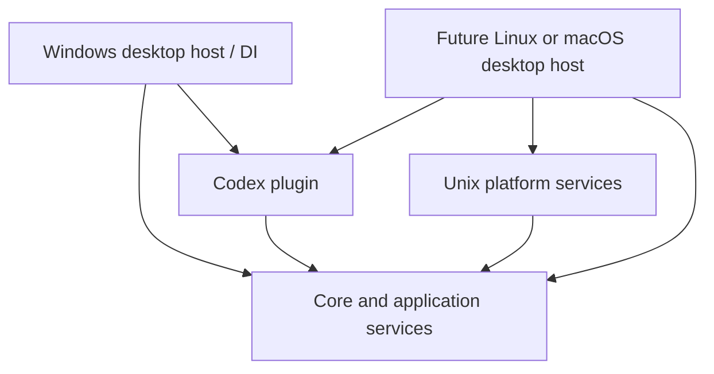

# Codex Monitor architecture

## Project boundaries

| Project | Responsibility |
| --- | --- |
| `src/CodexMonitor.Core/` | OS-neutral models, settings, history, alert policy, application coordinator, platform and desktop contracts |
| `src/CodexMonitor.Plugins.Codex/` | Codex CLI/app-server integration, parsing and dependency repair, with injected executable lookup |
| `src/CodexMonitor.Desktop.Windows/` | WinForms tray and dialogs, Windows executable locator, Windows startup integration and Microsoft DI composition root |
| `src/CodexMonitor.Platform.Unix/` | Reusable Linux/macOS PATH and executable discovery; no finished Unix graphical host yet |

All source projects are under `src/`. Top-level development folders stay lowercase:
`docs/`, `packaging/`, `scripts/`, `tests/` and `tools/`.

## Dependency direction

The application raises `UsageAlertSeverity`, not WinForms `ToolTipIcon`.
The `UsageCoordinator` exposes an immutable `DashboardState`; host-specific
`IDashboardView` implementations receive that state without needing to know
the plugin transport. `UsageDisplayText` provides OS-independent labels and
time/number formatting; actual fonts, layout, colors and tray integration
remain inside platform projects.

The Windows presentation contains `UsagePopup` (window and navigation),
`LimitsDashboardView`, `TokensDashboardView` and `MonitorTrayMenu`.
Alert state transitions are handled by `UsageAlertService`, while
`IProcessRunner` and `ICommandLaunchStrategy` isolate CLI execution
from provider parsing.

`IDesktopHost`, `IAgentDiscovery`, `IExecutableLocator` and `IStartupService`
form small platform boundaries. The Windows host owns the WinForms `ApplicationContext`;
it is not exposed as a shared abstraction.

The composition root provides exactly one `MonitorSettings`, `MonitorDatabase`,
`UsageHistory`, `UsageCoordinator` and cancellation source. The host merely
connects user actions to the coordinator and translates notifications.

## Plugin contract

`[UsagePlugin]` supplies identity, display name, description and CLI
executable names. Capability flags are derived from the implemented interfaces:
`IUsagePlugin` (limits), `ITokenUsagePlugin` (tokens) and
`IRepairableUsagePlugin` (dependency repair).

`IPluginCatalog` is populated by explicit DI registrations rather than a
global `PluginRegistry` or assembly-scanning magic. The list of known but
unsupported agents remains informational; discovering a CLI does not grant
monitoring functionality.

## Compatibility and remaining work

- The Windows executable is still `CodexMonitor.exe` and is built by
  `scripts/build-installer.ps1` using the new Windows project path.
- The native WinForms interface remains on Windows. Its large popup and tray
  shell are now split into smaller components without changing their intended
  controls, refresh cadence or persisted formats.
- Persisted files (`settings.json`, `monitor.db.json` and legacy
  `history.json`) retain their schema and Windows locations.
- Linux and macOS are **not yet supported as running desktop applications**.
  They need a shared cross-platform UI (e.g. Avalonia) with platform-specific
  tray integration, startup implementations, packaging and validation.
  Wayland/X11 and macOS menu bar behavior can differ even if the popup UI is shared.
- Before enabling a second provider, scope persisted history and alert states
  by plugin ID and provide selection in the UI.

The goal is to isolate concrete variations, not to wrap every control or
single-use data record in an interface.

## Build validation

`dotnet build CodexMonitor.slnx -c Release` must pass before merging.
GitHub-hosted Actions jobs are not currently allocated runners (jobs fail
before steps and logs), so the workflow is manual-only until that is resolved.
No runtime or Windows UI smoke test has been performed by this refactor.
