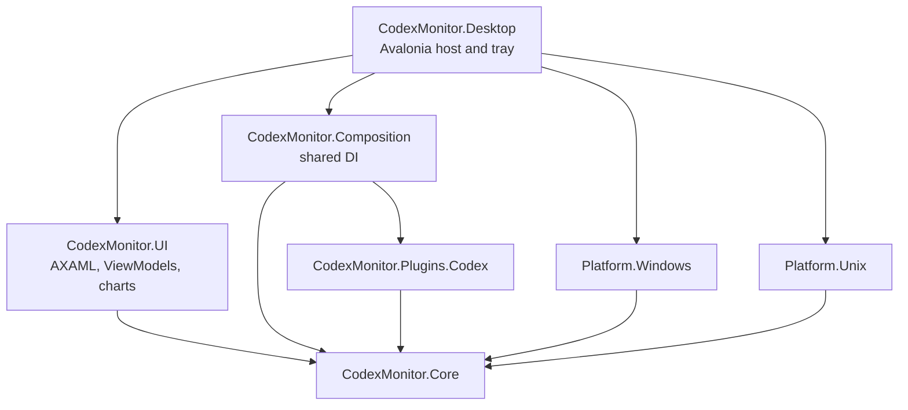

# Architecture — shared Avalonia desktop

## Dependency direction



The **only** graphical implementation is Avalonia. The Windows and Unix
WinForms/code-only dashboard projects have been removed. A single
`DashboardViewModel` translates `DashboardState` into values for AXAML.
The same controls render via Avalonia's cross-platform drawing backend.
No renderer-per-OS code or user-defined layout language is maintained.

## Responsibilities

| Project | Owns |
| --- | --- |
| `Core` | Domain models, `UsageCoordinator`, `UsageAlertService`, JSON store, contracts, agent selection |
| `Plugins.Codex` | Codex usage CLI, app-server protocol and parsing |
| `Composition` | Singleton services, one settings instance, one database/history pair, plugin registrations |
| `UI` | Shared `DashboardWindow`, `LimitsView`, `TokensView`, `SettingsWindow`, `AgentStatusWindow`, AXAML styles, `UsageRing`, history chart and ViewModels |
| `Desktop` | One `AppBuilder`, `DesktopApp`, `DesktopHost`, `DesktopTrayShell`; the composition root chooses platform implementations |
| `Platform.Windows` | Registry startup, Windows PATH discovery, Windows process launching and notification adapter |
| `Platform.Unix` | Executable lookup, process launching; separate XDG/LaunchAgent, notification and window-close policies |

Platform selection is confined to `Desktop/Program.cs`. Shared UI and Core
do not contain large OS-specific conditionals. Platform-specific menu bar
behavior and tray limitations remain host concerns.

## Interaction flow

```text
Operating system host / tray menu
    -> UsageCoordinator, IAgentManager
    -> current provider capability interfaces (IUsagePlugin, ITokenUsagePlugin)
    -> DashboardState (domain)
    -> DashboardViewModel (presentation)
    -> DashboardWindow / LimitsView / TokensView (single AXAML tree)
```

The UI emits commands (refresh, repair, settings, token selection) through
an observable ViewModel. The host orchestrates operations, schedules timers,
shows dialogs and sends notifications via `IDesktopNotificationService`.
The GUI never installs or repairs a CLI automatically.

## Persistence

Only `monitor.db.json` schema `v1` and `settings.json` are supported.
Every history item includes an explicit plugin ID; alert keys are namespaced.
No old-file migration or fallback writer exists. Atomic updates, current
format recovery copies and persistence diagnostics remain.

## Plugin extension

`[UsagePlugin]` annotates stable identity and executable names. Optional
`ITokenUsagePlugin` and `IRepairableUsagePlugin` describe actual capabilities;
new adapters are registered explicitly with dependency injection.
`AgentCatalog` reports other installed CLIs without pretending they are
supported providers.

## Build/release limitations

This migration changes the Windows presentation from WinForms to Avalonia.
No matching public release should be announced until the Windows tray,
installer, Linux X11/Wayland behavior and macOS menu bar/bundle are built
and checked on their corresponding targets. GitHub-hosted build jobs have
previously failed before runner allocation; those failures do not validate
or invalidate the source. See `docs/RELEASE-GATE.md`.
