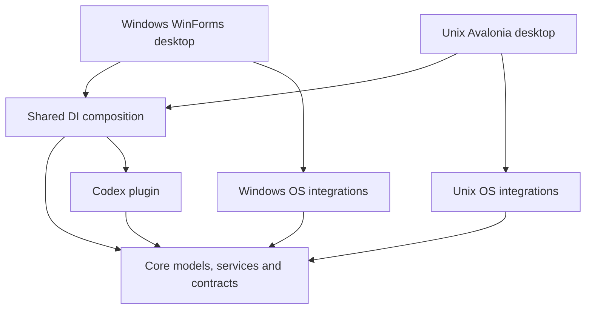

# Codex Monitor architecture

## Project boundaries

| Project | Responsibility |
| --- | --- |
| `src/CodexMonitor.Core/` | OS-neutral models, settings, history, alert policy, application coordinator, platform and desktop contracts |
| `src/CodexMonitor.Plugins.Codex/` | Codex CLI/app-server integration, parsing and dependency repair, with injected executable lookup |
| `src/CodexMonitor.Desktop.Windows/` | Native WinForms tray, settings, dashboard, Windows autostart and executable discovery |
| `src/CodexMonitor.Composition/` | Common DI registrations for plugin, coordinator, history, settings and persistence |
| `src/CodexMonitor.Platform.Unix/` | Linux/macOS executable lookup and command launch, separate storage paths and login startup |
| `src/CodexMonitor.Desktop.Unix/` | Experimental Avalonia 11 tray, dashboard, settings, diagnostics and desktop lifecycle |

All source projects are under `src/`. Top-level development folders stay lowercase:
`docs/`, `packaging/`, `scripts/`, `tests/` and `tools/`.

## Dependency direction

The application raises `UsageAlertSeverity`, not WinForms `ToolTipIcon`.
The `UsageCoordinator` exposes an immutable `DashboardState`; host-specific
`IDashboardView` implementations receive that state without needing to know
the plugin transport. `UsageDisplayText` provides OS-independent labels and
time/number formatting; actual fonts, layout, colors and tray integration
remain inside platform projects.

The Windows presentation contains `UsagePopup` (window and navigation),
`LimitsDashboardView`, `TokensDashboardView` and `MonitorTrayMenu`.
Alert state transitions are handled by `UsageAlertService`, while
`IProcessRunner` and `ICommandLaunchStrategy` isolate CLI execution
from provider parsing.

`IDesktopHost`, `IAgentDiscovery`, `IExecutableLocator` and `IStartupService`
form small platform boundaries. The Windows host owns the WinForms `ApplicationContext`;
it is not exposed as a shared abstraction.

The composition module provides exactly one `MonitorSettings`, `MonitorDatabase`,
`UsageHistory`, `UsageCoordinator` and cancellation source in both desktop
hosts. Windows and Unix register their own `IAppPaths`, `IStartupService`,
`ICommandLaunchStrategy`, `IExecutableLocator` and UI services.

## Plugin contract

`[UsagePlugin]` supplies identity, display name, description and CLI
executable names. Capability flags are derived from the implemented interfaces:
`IUsagePlugin` (limits), `ITokenUsagePlugin` (tokens) and
`IRepairableUsagePlugin` (dependency repair).

`IPluginCatalog` is populated by explicit DI registrations rather than a
global `PluginRegistry` or assembly-scanning magic. The list of known but
unsupported agents remains informational; discovering a CLI does not grant
monitoring functionality.

## Compatibility and remaining work

- Release 0.5.1 keeps the Windows executable name `CodexMonitor.exe` and is built by
  `scripts/build-installer.ps1` using the new Windows project path.
- The native WinForms interface remains on Windows. Its large popup and tray
  shell are now split into smaller components without changing their intended
  controls, refresh cadence or persisted formats.
- Persisted files (`settings.json`, `monitor.db.json` and legacy
  `history.json`) retain their schema and Windows locations.
- Linux/macOS now have an **experimental**, shared Avalonia desktop host with
  a real window and tray menu. It has not been compiled or validated on target
  systems and must not yet be presented as supported. Native notifications use optional Linux/macOS adapters with an in-window
  fallback. Packaging validation and full visual parity with Windows remain unfinished.
  Wayland/X11 and macOS menu bar behavior can differ even if the popup UI is shared.
- Persisted history and alert states are scoped by plugin ID. The internal
  agent manager can replace the active adapter after a later scan; a user
  facing preferred-agent picker remains future work when a second supported
  provider is added.
- A failed automatic read never installs or replaces a dependency. Repair is an
  explicit user action, while provider fallback is limited to process,
  protocol and schema failures that are safe to retry with the alternate CLI.
  Both the PyPI package and the Git fallback are pinned to reproducible
  versions (the Git source uses the v0.4.1 commit hash).

The `AgentManager` owns the current discovery snapshot and selected adapter.
Hosts refresh that manager on their configured scan interval; a changed
selection is propagated to the coordinator and dashboard without restarting
the process. The built-in catalog is still compiled into the application, so
this is an internal extension point rather than a public DLL loader.

`MonitorDatabase` preserves unreadable JSON as a timestamped `.corrupt.*`
copy, recovers a valid `.bak` when possible, and commits candidate documents
only after the atomic file replacement succeeds. Persistence failures remain
visible in the dashboard while the last good in-memory values stay available.

The goal is to isolate concrete variations, not to wrap every control or
single-use data record in an interface.

## Build validation

`dotnet build CodexMonitor.slnx -c Release` must pass before merging. For
0.5.1 it passes on Windows together with the parser checks and native
screenshot checks. `scripts/build-installer.ps1` also produces the 0.5.1 Inno
Setup package locally. GitHub Actions now runs the solution build and console
checks on pushes and pull requests for all three target operating systems.
