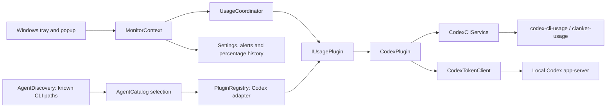

# Architecture

The application remains one native WinForms executable. Plugins are internal C# adapters compiled into it, not separately downloaded packages. Only Codex is registered.

## Responsibilities

| Layer | Owns | Does not own |
| --- | --- | --- |
| `Core/` | Normalized snapshots, plugin metadata/capabilities, local history, settings and alert policy | JSON wire formats, WinForms, provider commands |
| `App/UsageCoordinator.cs` | Refresh scheduling, in-memory state, stale/error transitions, alert events | Forms, tray menus, provider-specific commands |
| `Plugins/Codex/` | Schema parsers, window priority, process launch, timeouts, dependency repair | UI controls and persistent app preferences |
| `Plugins/PluginRegistry.cs` | Explicit adapter list; rejects unsupported IDs | Assembly scanning or a marketplace |
| `Core/AgentCatalog.cs` | Known agent definitions and deterministic source selection | Executable launching or provider-specific parsing |
| `Infrastructure/Windows/AgentDiscovery.cs` | PATH and Windows install-location detection | Reading credentials or claiming unsupported adapters work |
| `App/MonitorContext.cs` | Windows lifetime, timers, tray actions and popup wiring | Direct Codex calls, JSON parsing and refresh state |
| `UI/` | Presentation, English text, accessibility, sizing | Account access or external processes |
| `tools/Screenshots/` | Synthetic data and offscreen rendering of actual UI | Production dependencies or user data |
| `packaging/` and `scripts/` | Inno Setup definition and repeatable build commands | Runtime application code |

`Program` selects Codex and injects `IUsagePlugin` into the shell. `MonitorContext` is a thin Windows host; `UsageCoordinator` owns refreshes and state transitions. `PluginInfo` supplies the provider name, tray choices and token/repair capabilities. The shell gates calls and the popup gates controls using those capabilities. The adapter returns windows in priority order; the shared model contains no provider-specific priority rules.

Agent discovery and plugin support are separate concepts. The Windows scanner only checks whether known executable names exist in safe search locations. `AgentCatalog.Select` then applies one deterministic rule: a saved preferred supported agent wins; otherwise the first installed supported agent wins; if no supported agent is installed, the Codex adapter remains available for repair. Unsupported agents are visible in the diagnostic dialog but cannot be selected or launched.

Limits, tokens and agent discovery have independent refresh policies stored in `MonitorSettings`. Limits default to five minutes, tokens to 30 minutes and discovery to 30 minutes; the UI exposes safe presets and can turn off background token polling. A manual Tokens refresh remains available. `MonitorDatabase` is a small atomic JSON store at `%LOCALAPPDATA%\CodexMonitor\monitor.db.json`: it keeps limit samples and the last successful token snapshot, so the dashboard can render cached data immediately after restart. The old `history.json` format is migrated on first load. Shutdown cancels work. The Codex token client initializes the local app-server, requests `account/usage/read` without params, and closes the process. Native `codex.exe` and npm's `codex.cmd` preserve redirected stdio; the PowerShell npm shim is not used.

## Adding a provider later

1. Implement `IUsagePlugin` in `Plugins/<Provider>/`. Translate its wire format into shared records and declare only working capabilities.
2. Add parser, failure and cancellation checks. A provider without token data must not advertise it.
3. Add the provider's `AgentDefinition` and detection names, then register its adapter explicitly. Detection alone must not make an unsupported provider selectable.
4. Before registering a second provider, namespace persisted history, preferences and alert state by plugin ID, migrating existing Codex files. Current storage remains compatible with the single-provider app.
5. Add provider selection and corresponding UI tests when both adapters work. Never silently fall back from an unknown provider to Codex.

This boundary is preparation, not a promise that every provider fits unchanged. Process discovery, WinForms, autostart and the installer remain Windows-specific. A platform port requires another host/UI and platform integration.

## Verification

`tests/ParserChecks.csproj` covers Codex response shapes, optional token fields, deduplication, invalid values, registry behavior, alerts and history. The screenshot project checks capabilities and window sizing without starting a provider process. Installer smoke checks require an isolated Windows environment; they should not overwrite an existing installation as a test.
